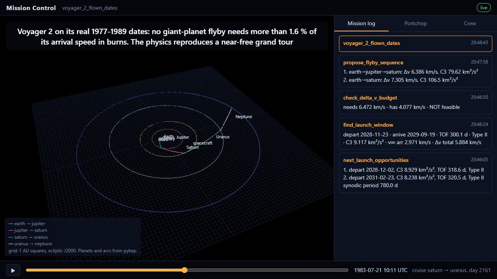

# Mission Control

A 3D solar system in the browser, running on real orbital mechanics. A crew of AI agents designs
space missions from a plain-English goal, then briefs you on what they tried and why the final
route won.



To make the 72-second demo video from the real app, run `pixi run python -m scripts.make_demo_video`. It needs Chrome or Edge and ffmpeg.

The rule that shapes everything: **agents orchestrate, pykep computes.** Every number an agent
states must come from a physics tool call. A grounding check enforces this by tracing each number
and date in a report back to a tool result. Reports that fail go back to the agent; if they still
fail, they are shown with the untraced numbers marked.

Physics is [pykep](https://esa.github.io/pykep/) (ESA Advanced Concepts Team). Licence: Apache-2.0.

## What is here

| Path | What it does |
|---|---|
| `physics/` | Lambert transfers, launch-window search, Kepler propagation, Hohmann transfers, Δv budgets, gravity-assist sequences, and the geometry for the 3D view |
| `mcp_server/` | The physics as MCP tools: `next_launch_opportunities`, `find_launch_window`, `solve_transfer`, `propose_flyby_sequence`, `propagate`, `hohmann_transfer`, `check_delta_v_budget`. Each result is also pushed to the browser |
| `bridge/` | Loopback-only server for the web app and a websocket relay |
| `web/` | three.js scene with a time slider, porkchop plot, mission log and crew chat |
| `agents/` | Crew roles (flight director, navigator, propulsion), one model adapter for free-tier models, and the tool-calling loop |
| `evals/` | Ten mission tasks with published answers, used to score models |

## Setup (Windows, Linux, macOS)

pykep has no Windows pip wheel, so the environment comes from conda-forge through [pixi](https://pixi.sh):

```
pixi install
pixi run test          # about 100 tests; takes about 2 minutes
```

## Use it

**Watch missions in 3D.** Start the bridge, then open http://127.0.0.1:8765/

```
pixi run bridge
```

**Ask the crew.** The crew runs on free tiers only: Groq by default, or Gemini or a local Ollama.
Put keys in a `.env` file in the repo root. It is gitignored; never commit keys.

```
GROQ_API_KEY=...
GEMINI_API_KEY=...
```

```
pixi run crew "Send an orbiter with 1500 kg dry mass, 4000 kg of propellant and a 320 s engine to Mars in the next window. Can it make it?"
pixi run crew --model gemini --model-name gemini-3.1-flash-lite "..."
```

Crew chat and every tool result appear live in the browser. Each mission is saved to `missions/` as a
JSON transcript and a readable markdown log. Two real runs on Groq's free tier are in
[`docs/example-missions/`](docs/example-missions/):
- a Mars orbiter, where the crew finds the 2028 window and the spacecraft falls short of the Δv it needs;
- a Saturn flyby, comparing direct against a Jupiter assist.

**Use the tools from Claude.** `.mcp.json` registers the physics server for Claude Code in this folder.
For Claude Desktop, add this to `claude_desktop_config.json`, changing the path to your checkout:

```json
{"mcpServers": {"mission-control-physics": {"command": "pixi",
  "args": ["run", "--manifest-path", "C:\\path\\to\\mission-control\\pixi.toml", "mcp-server"]}}}
```

**Score models.** See [`evals/README.md`](evals/README.md) and the latest [`evals/RESULTS.md`](evals/RESULTS.md).

```
pixi run eval --model groq
pixi run eval --model claude      # through the Claude Code CLI on your own plan
```

## What has been checked, and against what

Every reference names its source in `physics/references.py`, with a note on how it was verified.

| Check | Reference | Result |
|---|---|---|
| Lambert solver | Curtis, *Orbital Mechanics for Engineering Students* 3rd ed., Ex. 5.2; Vallado 4th ed., Ex. 7-5 (short and long way) | within 0.1 % |
| Earth to Mars transfers | NASA/TM-2010-216764, Tables 2 and 3 (7 transfers, both ephemerides) | within 0.10 % |
| Launch-window optima | NASA/TM-2010-216764, Table 1: 2026 C3 9.144, 2028 C3 8.928 km²/s² | 9.139 and 8.929, departure within 2 days |
| Next launch opportunities | same table, found by scanning a synodic period | same dates and C3 |
| Kepler propagation | Curtis Ex. 3.7 | 0.014 % (the book rounds its working) |
| Orbital elements | Curtis Ex. 4.3 † | all elements at 4 s.f. |
| Hohmann transfer | closed-form vis-viva; Vallado Ex. 6-1 † | exact; all 7 recalled digits |
| Gravity assist, inner | Mariner 10, NASA NSSDCA 1973-085A | Venus flyby free (1e-5 km/s) at the flown time |
| Gravity assist, outer | Voyager 2, NASA NSSDCA 1977-076A | Jupiter, Saturn and Uranus flybys need under 2 % of v∞ on the flown days; Saturn moved by 60 days costs 2.7-11 % |
| Rocket equation | Tsiolkovsky, g0 = 9.80665 m/s² | exact |

† Recalled from the book, not yet checked against the printed page. pykep matches every recalled digit,
which rules out a garbled memory but not a wrong example number.

**Model limits.** The model is patched conics with impulsive burns, single-revolution Lambert arcs,
and flybys as an instant turn of v∞. There are no deep-space manoeuvres and no low thrust.
`jpl_lp` ephemerides cover 1800-2050; `de440s` covers 1849-2150.
